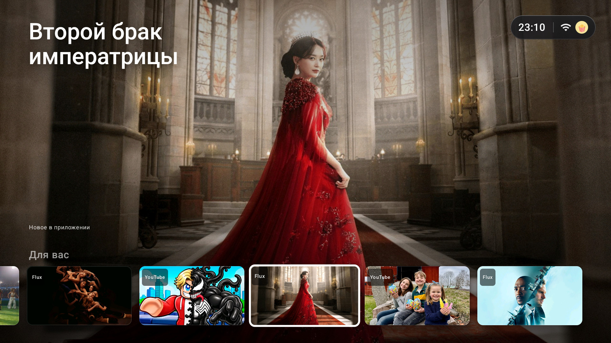
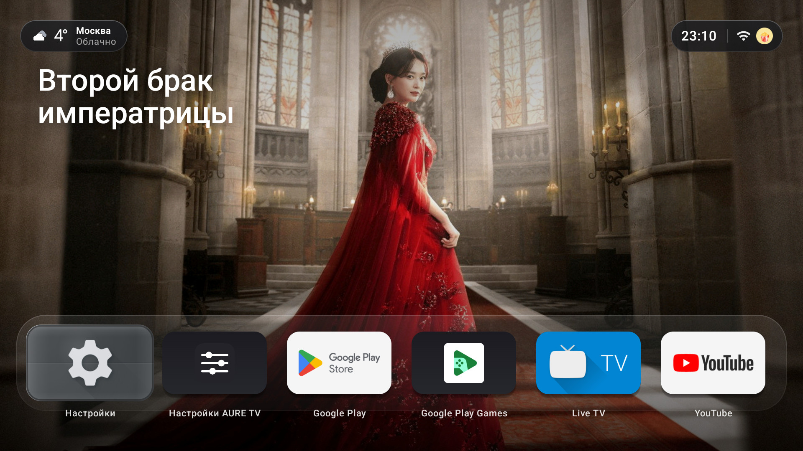
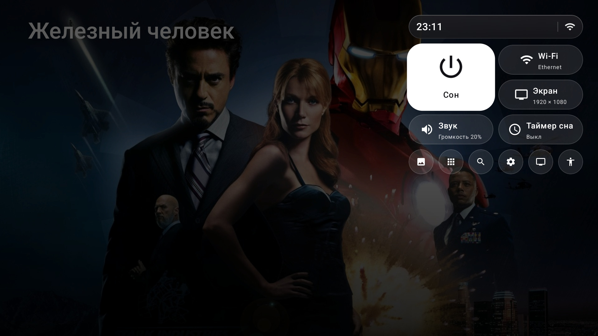
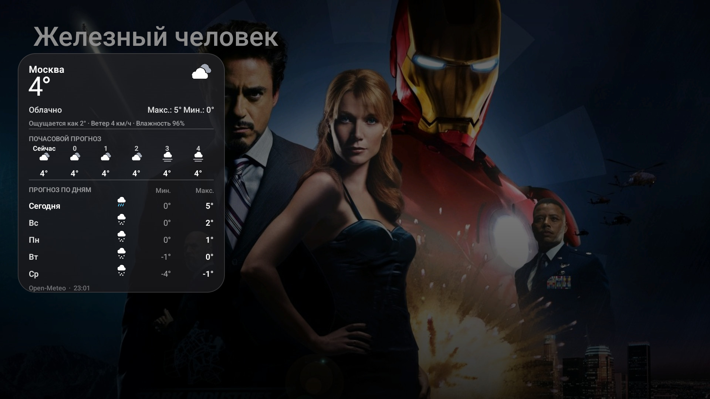
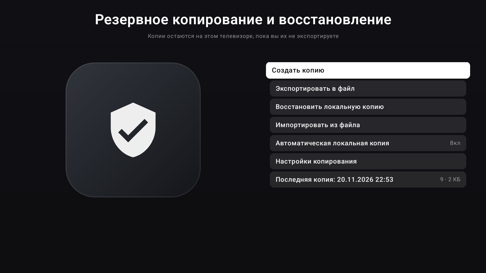

# AURE TV 0.6.0

The first public build of **AURE TV**, a remote-first Android TV launcher with a
tvOS-inspired Home, real Watch Next recommendations, Aerial ambience and
local-first backup.

## Highlights

- **Real recommendations, not placeholder cards.** The shelf reads Android TV
  Watch Next rows published by installed apps. The launcher itself does not
  bundle a catalogue.
- **Home built around the remote.** App grid and dock, folders, hide/rename,
  profiles, Kids Mode, remote-first search, weather and a Control Center.
- **Aerial ambience.** Apple Aerial clips with themes, Clock, Minimal, Photos and
  Reddit modes; 1080p H.264 compatible chain with a finite fallback. Higher
  renditions are only tried when the TV reports support.
- **Backup & Restore.** Local snapshots and export/import, optional
  AES-256-GCM password protection, category restore, rollback copy and automatic
  local backups.
- **Privacy by default.** No account, analytics, ads or telemetry. Online
  metadata and trailers are optional and never used in Kids Mode.
- **English and Russian UI**, six-page setup, signed release APK.

## Screenshots

The repository README has the full gallery. The
`GITHUB_RELEASE/screenshots/` folder contains the same images at 1920×1080 for
the release page:

- `01-home-recommendations.jpg` — Watch Next cards in the shelf
- `02-home-apps.jpg` — Home grid and dock
- `03-control-center.jpg` — network, display, sound and sleep timer
- `04-weather.jpg` — current conditions and five-day forecast
- `05-search.jpg` — remote-first search
- `06-ambient-aerial.jpg` — Aerial ambience
- `07-backup-restore.jpg` — Backup & Restore
- `08-settings.jpg` — Settings
- `09-ambient-settings.jpg` — Aerial themes and quality
- `10-setup.jpg` — first-run setup

## Gallery

| Real Watch Next recommendations | Home apps and dock |
| --- | --- |
|  |  |

| Control Center | Weather |
| --- | --- |
|  |  |

| Aerial ambience | Backup & Restore |
| --- | --- |
|  |  |

## Install

Requirements: Android TV 9+ (API 28). No Google account is required for the
launcher itself.

```bash
adb install AURE-TV-0.6.0.apk
```

Open **AURE TV**, finish setup, then choose it as the TV's Home app. Allow
**Recommendations Access** (`READ_TV_LISTINGS`) if you want Watch Next cards; an
installed provider must publish rows for cards to appear.

## Verification

Checked on the `hume-tv` Android TV emulator (API 34, x86, 1920×1080):

- JVM unit tests: **582 / 582**
- Connected instrumentation tests: **305 / 305**
- Android lint: **0 errors, 17 warnings**
- Release APK: signed, APK Signature Scheme v2
- Package/version: `app.aure.tv`, **0.6.0** (`versionCode 154`)

Not yet verified on physical hardware: real IR/BT remotes, HDMI-CEC, 4K/HDR
decoding on a real panel, TalkBack voice output and OEM file pickers.

## Known limitations

- Aerial playback and recommendations need network access; offline use keeps
  local Aerial stills or the clock.
- The optional in-app update channel is **not configured** in this build.
  Update checks report that no source is available.
- Kids Mode is an in-app boundary. System Settings, another Home app or another
  app can bypass it.
- `app.aure.tv` is a fresh install identity, not an in-place upgrade from the
  old package.

## Checksum

```text
df6b96724c3feeef1d6025fc5046a0c890cedacbd89adba04ca5f266639b120a  AURE-TV-0.6.0.apk
```

Size: 6,960,986 bytes.

AURE TV is licensed under Apache-2.0. Aerial clips come from Apple's public CDN;
AURE TV is not affiliated with Apple. Third-party product names belong to their
owners.
