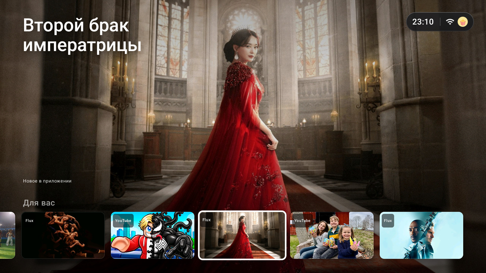
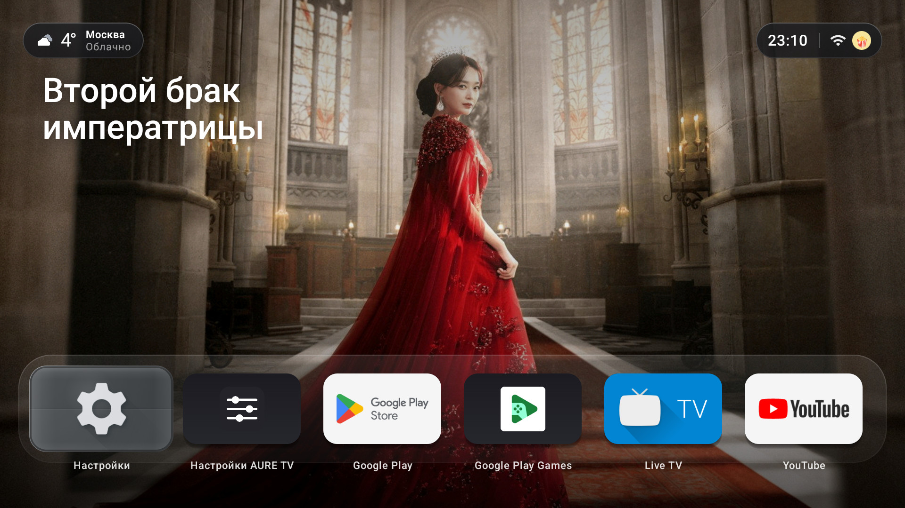
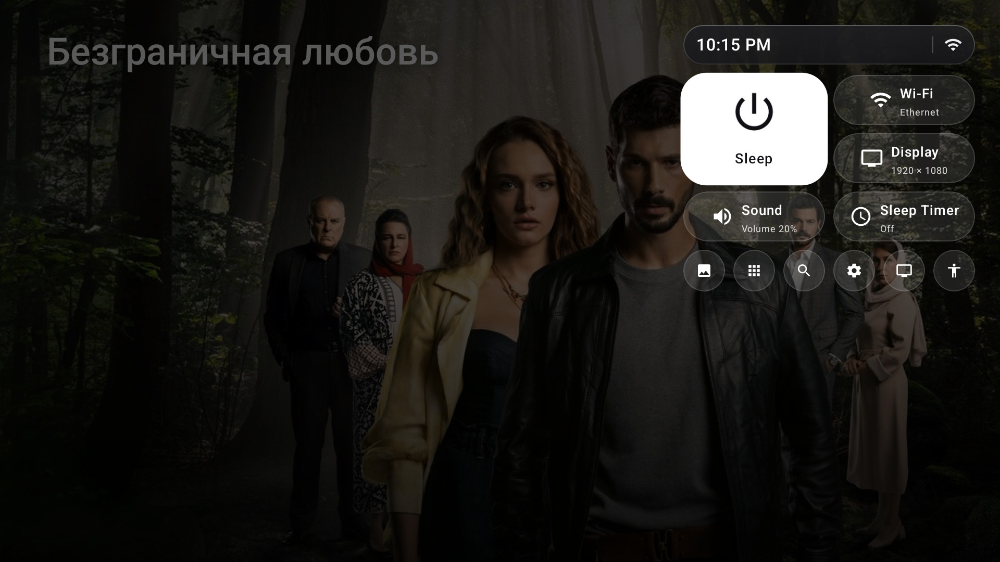
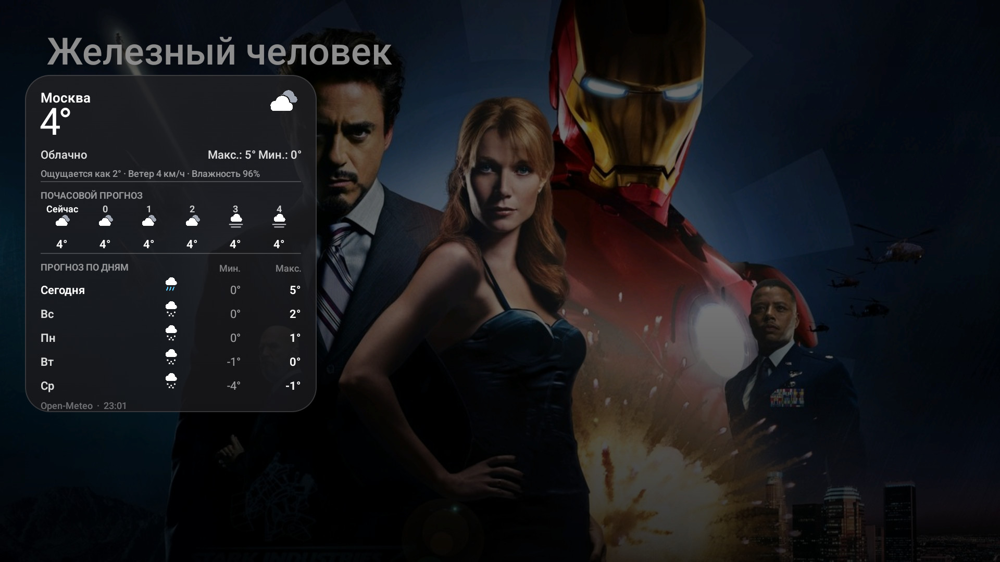
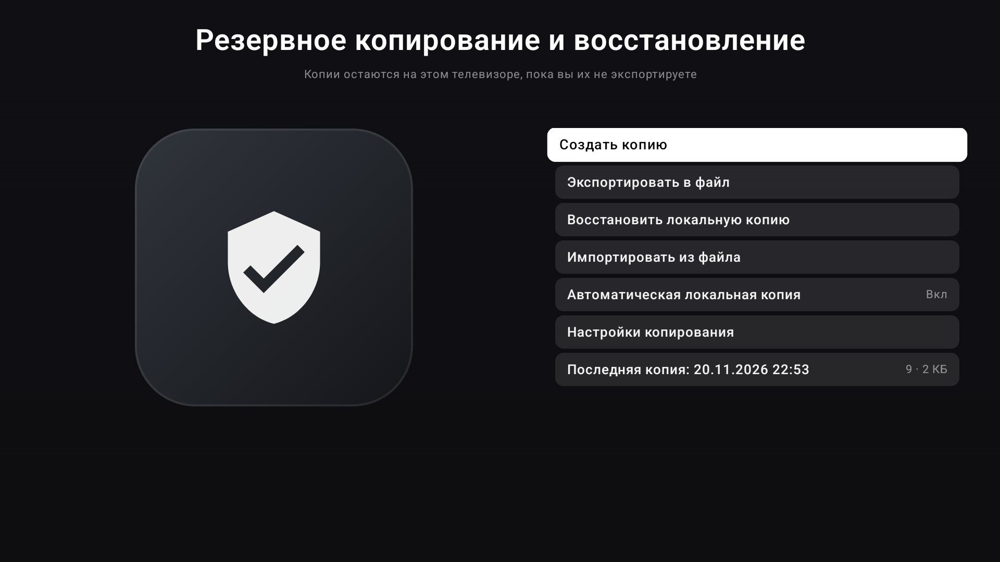

# AURE TV 0.6.0

Первый публичный выпуск **AURE TV** — лаунчера для Android TV, заточенного под
пульт: Главная в духе tvOS, реальные рекомендации Watch Next, Aerial-заставка и
локальные резервные копии.

> **Новый идентификатор приложения:** это `app.aure.tv`. Он не обновляет старую
> установку `com.whatuneed.ovisiontv.kotlin`. Выгрузите резервную копию из
> старого приложения и импортируйте её в AURE TV либо удалите старое после
> переноса.

## Главное

- **Реальные рекомендации, а не декоративные карточки.** Полка читает строки
  Android TV Watch Next, опубликованные установленными приложениями. Проверено
  с **Flux** и **YouTube**; другие источники работают так же. Своего каталога
  лаунчер не содержит.
- **Главная для управления пультом.** Сетка и док, папки, скрытие и
  переименование, профили, детский режим, поиск с пульта, погода и Control
  Center.
- **Aerial-заставка.** Клипы Apple с темами, режимы Clock, Minimal, Photos и
  Reddit; совместимая цепочка 1080p H.264 с конечным откатом. Более высокие
  рендишены пробуются только при поддержке телевизора.
- **Backup & Restore.** Локальные снимки и экспорт/импорт, необязательная
  защита паролем AES-256-GCM, восстановление по категориям, копия для отката и
  автоматические локальные копии.
- **Приватность по умолчанию.** Нет аккаунта, аналитики, рекламы и телеметрии.
  Онлайн-метаданные и трейлеры необязательны и не используются в детском режиме.
- **Интерфейс на английском и русском**, настройка из шести экранов, подписанный
  release APK.

## Скриншоты

Полная галерея — в README репозитория. В
`GITHUB_RELEASE/screenshots/` лежат те же изображения в 1920×1080 для страницы
релиза:

- `01-home-recommendations.jpg` — карточки Flux/YouTube в полке Watch Next
- `02-home-apps.jpg` — сетка приложений и док
- `03-control-center.jpg` — сеть, дисплей, звук и таймер сна
- `04-weather.jpg` — текущая погода и прогноз на пять дней
- `05-search.jpg` — поиск с пульта
- `06-ambient-aerial.jpg` — Aerial-заставка
- `07-backup-restore.jpg` — Backup & Restore
- `08-settings.jpg` — Настройки
- `09-ambient-settings.jpg` — темы и качество Aerial
- `10-setup.jpg` — первичная настройка

## Галерея

| Реальные рекомендации из Flux | Приложения и док |
| --- | --- |
|  |  |

| Control Center | Погода |
| --- | --- |
|  |  |

| Aerial-заставка | Резервные копии |
| --- | --- |
|  |  |

## Установка

Требования: Android TV 9+ (API 28). Для самого лаунчера аккаунт Google не нужен.

```bash
adb install AURE-TV-0.6.0.apk
```

Откройте **AURE TV**, завершите настройку и выберите лаунчер домашним
приложением. Разрешите **Recommendations Access** (`READ_TV_LISTINGS`), если
нужны карточки Watch Next; установленный источник вроде Flux или YouTube должен
публиковать строки, иначе карточек не будет.

## Проверка

Проверено на эмуляторе Android TV `hume-tv` (API 34, x86, 1920×1080):

- JVM unit-тесты: **582 / 582**
- Connected instrumentation: **305 / 305**
- Android lint: **0 ошибок, 17 предупреждений**
- Release APK: подписан, APK Signature Scheme v2
- Пакет/версия: `app.aure.tv`, **0.6.0** (`versionCode 154`)

Не проверено на физическом железе: реальные ИК/BT-пульты, HDMI-CEC,
декодирование 4K/HDR на реальной панели, голос TalkBack и файловые пикеры
разных OEM.

## Известные ограничения

- Для Aerial и рекомендаций нужна сеть; офлайн остаются локальные кадры Aerial
  или часы.
- Необязательный канал обновлений в этой сборке **не настроен**. Проверка
  обновлений честно сообщает об отсутствии источника.
- Детский режим — граница внутри приложения. Системные настройки, другой
  лаунчер или другое приложение могут её обойти.
- `app.aure.tv` — новая установка, а не обновление поверх старого пакета.

## Контрольная сумма

```text
df6b96724c3feeef1d6025fc5046a0c890cedacbd89adba04ca5f266639b120a  AURE-TV-0.6.0.apk
```

Размер: 6 960 986 байт.

AURE TV распространяется по Apache-2.0. Клипы Aerial — с публичного CDN Apple;
AURE TV не связан с Apple. Названия Flux, YouTube и других продуктов принадлежат
их владельцам.
