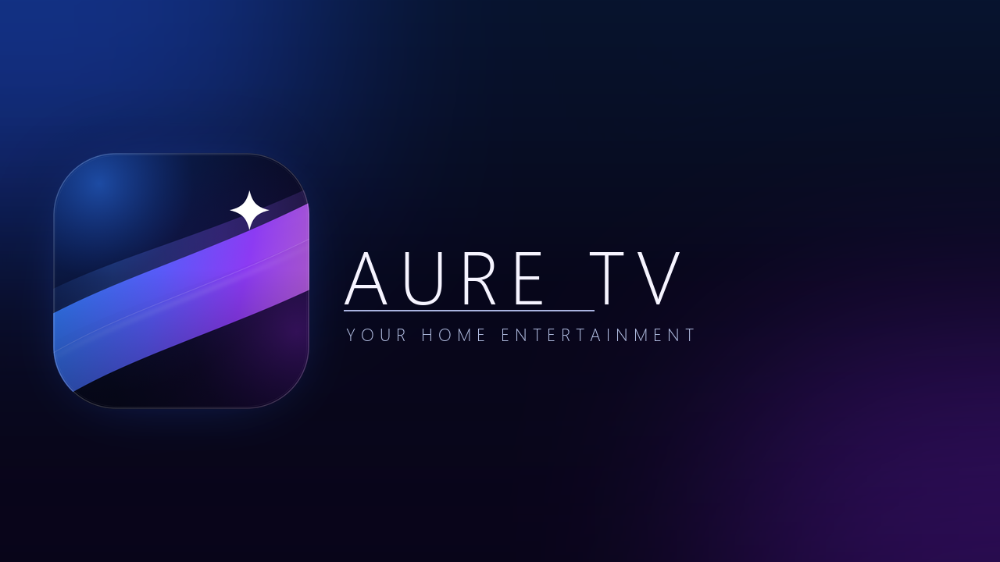
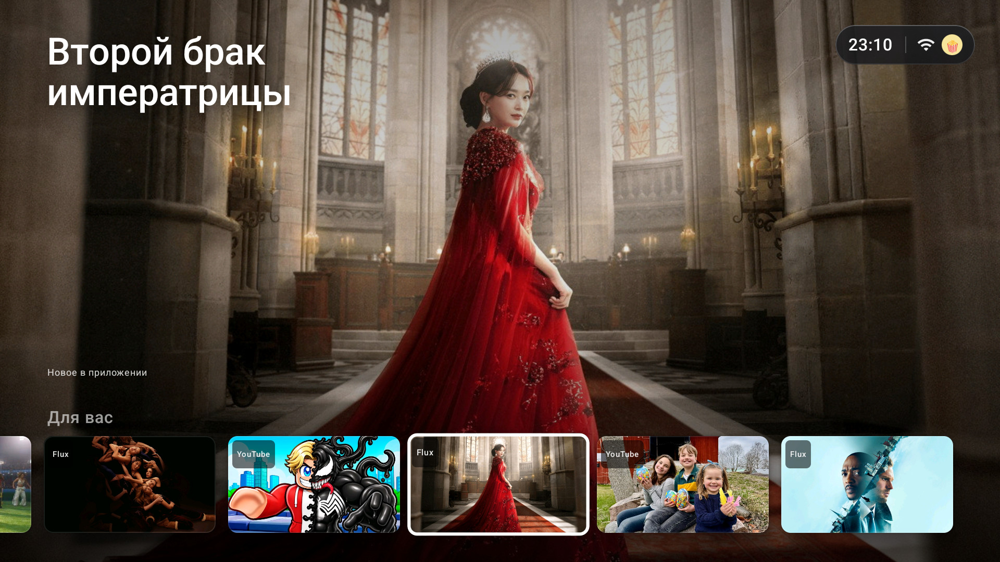
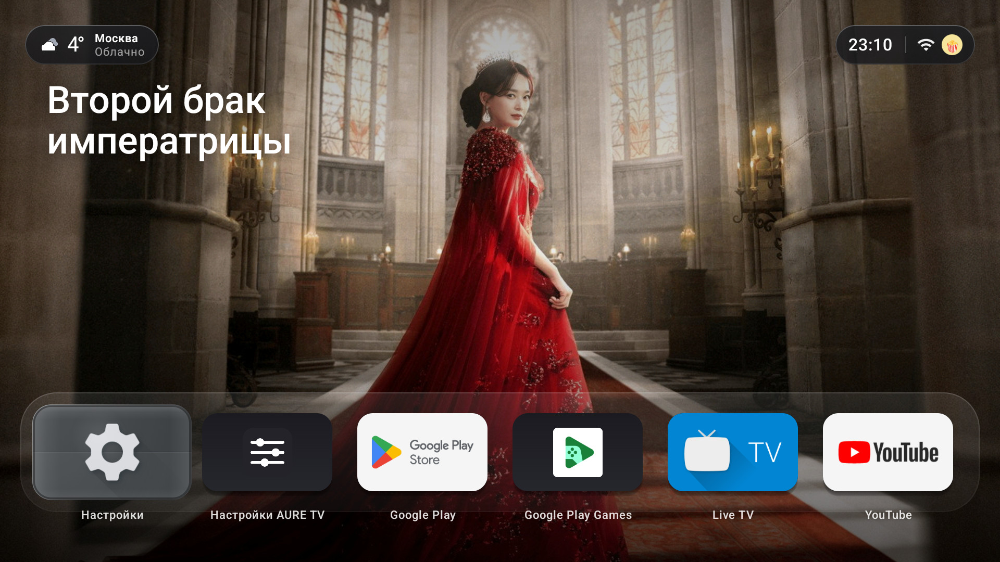
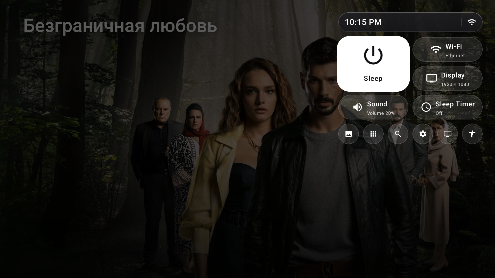
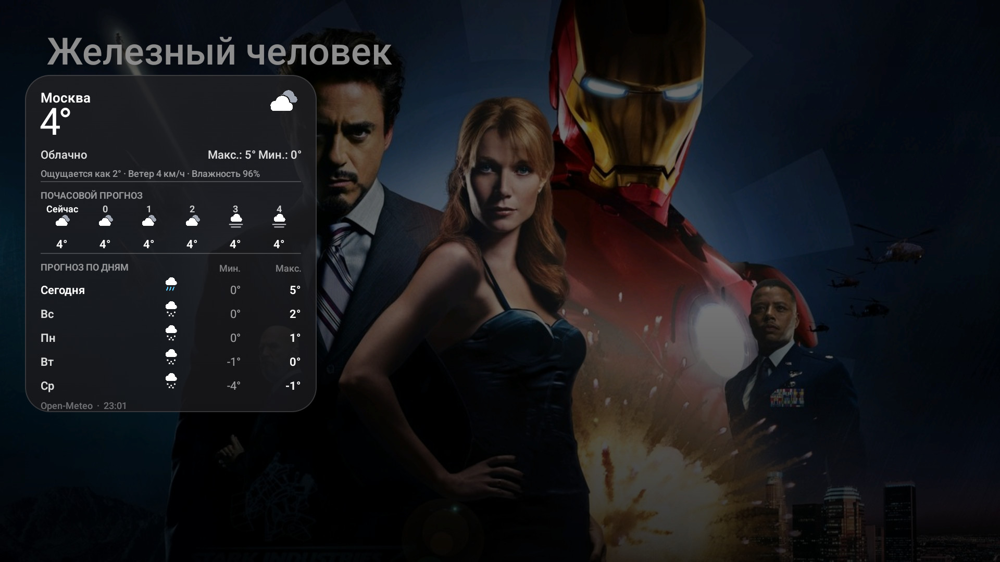
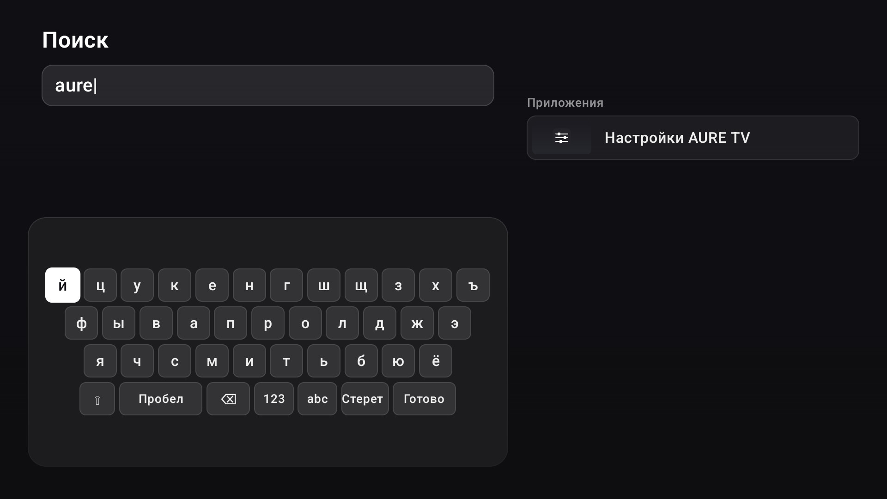
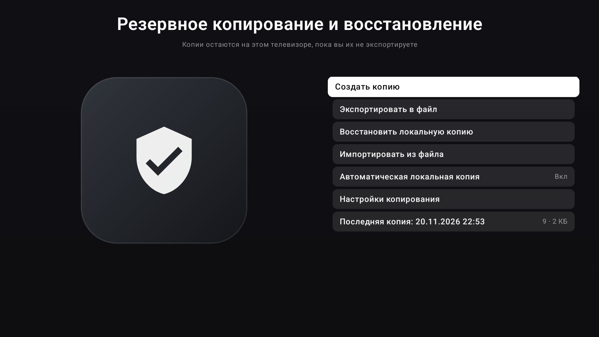
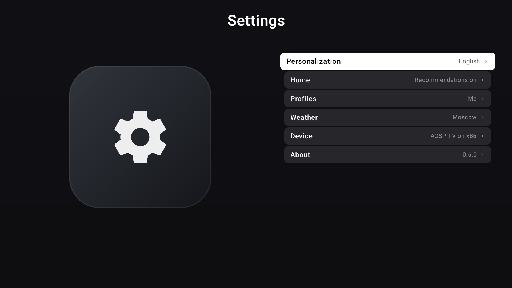
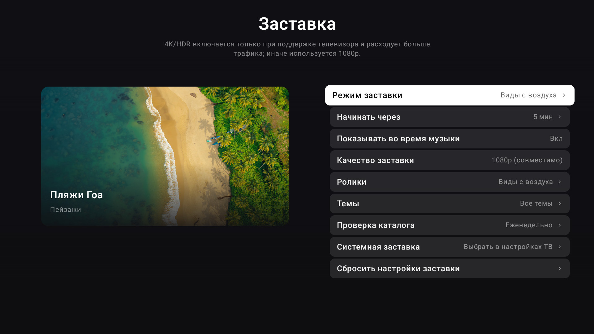
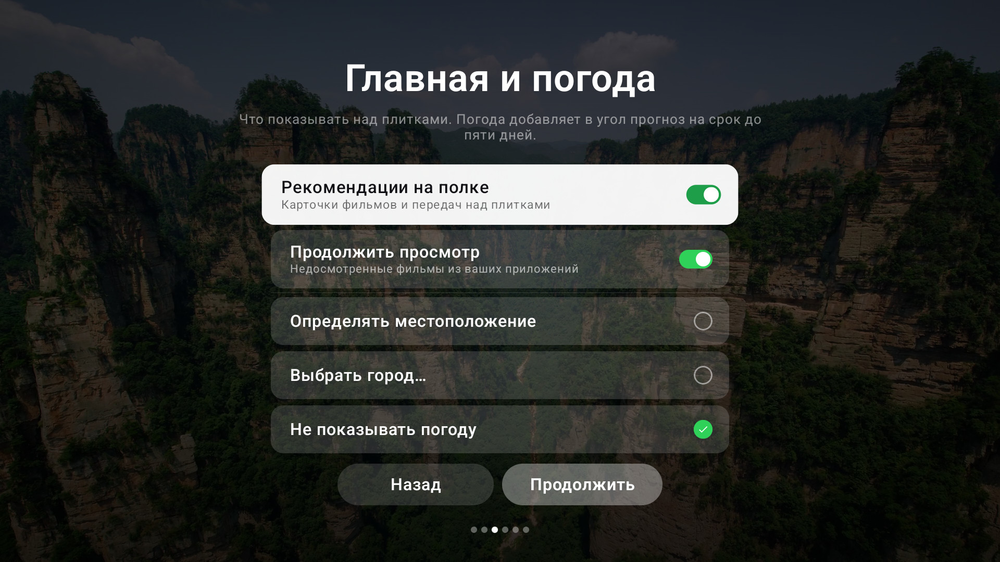

# AURE TV

**A remote-first Android TV launcher with a tvOS-inspired Home, real Watch Next recommendations, Aerial ambience and local-first backup.**

[Русская версия](README.ru.md) · [Download AURE TV 0.6.0](https://github.com/whatuneeed/AureTV/releases/latest) · [Interactive preview](https://whatuneeed.github.io/AureTV/) · Android TV 9+ (API 28) · Kotlin + Jetpack Compose · Apache-2.0



AURE TV is a home screen, not another streaming catalogue. It brings the apps
you already use into one quiet surface: a focus-driven app grid, folders,
profiles, the system Watch Next shelf, weather, a Control Center and a
customisable ambient screen. Recommendations are published by installed apps;
AURE TV does not invent titles or fake a content library.

## Try it in a browser

[Open the interactive preview](https://whatuneeed.github.io/AureTV/) to click
through the Home shelf, search, Control Center, weather, Settings and Aerial
mode. It uses keyboard, D-pad and mouse navigation, switches between Russian and
English, and keeps everything local in the page. The preview uses fictional demo
titles and is not the installable APK.

## Screenshots

| Real recommendations from installed apps | Home apps and dock |
| --- | --- |
|  |  |

| Control Center | Weather |
| --- | --- |
|  |  |

| Remote-first search | Aerial ambience |
| --- | --- |
|  |  |

| Backup & Restore | Settings |
| --- | --- |
|  |  |

<details>
<summary>More screens: Ambient settings and first-run setup</summary>

| Ambient Experience | Setup |
| --- | --- |
|  |  |

</details>

The shelf in the first screenshot shows real Watch Next rows published by
installed apps on the test device. Provider apps are not bundled; the launcher
reads the TV provider rows they expose. If no installed app publishes a row,
the shelf stays empty instead of showing placeholder cards.

## Why AURE TV

- **Made for a remote, not a mouse.** The D-pad cursor is the source of truth;
  focus, Back, OK and Menu have explicit destinations on every surface.
- **Real content only.** The shelf uses Android TV Watch Next. Posters, titles
  and provider labels come from installed apps. No invented catalogue, no fake
  playback state.
- **A calm Home.** No feeds fighting for attention, no advertising and no
  account. Hide, rename and group apps; keep the Home screen yours.
- **Local-first by default.** Backups are local files, optionally protected by a
  password. There is no analytics or advertising SDK.
- **A complete TV surface.** Weather, search, profiles and Kids Mode, a Control
  Center, Aerial/Clock/Photos/Reddit ambience, and a six-page first-run wizard.
- **Bilingual UI.** English and Russian, with the same feature set in both.

## Features

### Home and navigation

- Focus-first app grid with a dock, folders, reordering, hide/rename actions
  and a dedicated app menu.
- Search from a remote's Search/Assist key, with an on-screen D-pad keyboard.
- Profiles with name, emoji and colour; a separate Kids Mode with an exit PIN
  and an app allowlist.
- Optional Weather capsule with current conditions, hourly details and a
  five-day forecast. Weather uses Open-Meteo with fallback providers.
- A Watch Next shelf built from the system TV provider. Cards can open the
  installed app, show optional online details/trailer, or return to the provider
  when its deep link is available.
- Control Center for network status, display information, sound, sleep timer,
  search, Settings, ambient mode and the system TV surface.
- The stock TV launcher can be replaced by selecting AURE TV as the Home app;
  an optional Accessibility service handles devices that keep returning to the
  stock launcher. The service is not required for normal use.

### Ambient Experience

- **Aerials** — Apple's public Aerial catalogue with real clips and themes.
  The default compatible chain is 1080p H.264; higher renditions are selected
  only when the display and decoder report support, with a finite 1080p
  fallback.
- **Clock**, **Minimal**, **Photos** and **Reddit** modes. Photos stay on the
  TV; Reddit is an unmoderated third-party source and is disabled in Kids Mode.
- Aerial filters, start delay, pixel shift, dim timing, maximum session, weather
  and music behaviour.
- Offline-safe: if a clip or network request fails, the saver keeps a local
  still or the clock instead of going black.

### Backup and recovery

- Local snapshots plus export/import through Android's file picker.
- Select what to restore: profiles, Home layout, favourites/discovery, Kids
  allowlist, weather, saver, language/content and startup behaviour.
- Optional password protection using AES-256-GCM with PBKDF2-HMAC-SHA256.
- Validation, a restore journal and a rollback copy before selected settings
  are replaced. Automatic local backups can be enabled.
- Permissions and the Android Home role are intentionally not restored; the
  user grants those again on the new device.

### Privacy and network policy

- No account, analytics, advertising SDK or telemetry.
- Online metadata and trailers are optional and never used in Kids Mode.
- HTTPS-only clients with explicit redirect validation. The only cleartext
  exception is the documented Apple Aerial CDN host; external redirects are
  not followed blindly.
- Backups stay on the TV unless the user exports them. Photos and Reddit feeds
  are not included in backups.
- The launcher queries only the launcher/Home/TV-provider surfaces it needs;
  it does not request `QUERY_ALL_PACKAGES`.

### Updates

Builds from 0.6.1 onward check the signed release metadata at
`https://whatuneeed.github.io/AureTV/update.json`. The
`.github/workflows/publish-update.yml` workflow regenerates that file from the
APK attached to a published GitHub release, and GitHub Pages serves it. The
launcher downloads only over HTTPS from the allowed GitHub hosts, verifies
SHA-256, and delegates the final step to Android's PackageInstaller; updates are
never silent.

The published 0.6.0 artifact predates this channel, so it reports that no source
is configured. Installing a newer APK from GitHub Releases manually remains
possible.

## Install

**Requirements:** Android TV 9 or newer (API 28+). A Google account is not
required for the launcher itself.

1. Download `AURE-TV-0.6.0.apk` from the GitHub release.
2. Install it over ADB:

   ```bash
   adb install AURE-TV-0.6.0.apk
   ```

   Or open the APK with a file manager on the TV and confirm the system
   installer prompt.
3. Open **AURE TV** and complete the six-page setup.
4. To make it the Home app, choose **AURE TV** in the TV's Home/default-launcher
   setting. The exact path varies by OEM.
5. For recommendations, allow **Recommendations Access** when setup asks (or
   later in AURE TV Settings → Home). This grants `READ_TV_LISTINGS`; without it
   the shelf cannot read Watch Next rows.
6. A provider app that publishes Watch Next rows must be installed for its cards
   to appear.

## Verification

The 0.6.0 release candidate was checked on the `hume-tv` Android TV emulator
(API 34, x86, 1920×1080):

| Check | Result |
| --- | --- |
| JVM unit tests | 582 / 582 |
| Connected instrumentation tests | 305 / 305 |
| Android lint | 0 errors, 17 warnings |
| Release APK | signed, APK Signature Scheme v2 |
| Package / version | `app.aure.tv`, 0.6.0 (versionCode 154) |

**Not yet verified on physical hardware:** real IR/BT remotes, HDMI-CEC,
4K/HDR decoding on a real panel, TalkBack voice output, OEM file pickers and
the full API 28–35 device range. The emulator result is not a substitute for a
living-room TV test.

## Build

The project uses the Gradle wrapper and JDK 17.

```bash
./gradlew :app:assembleDebug
```

On the development workstation the Gradle cache lives in `C:/gradle-home`:

```bash
GRADLE_USER_HOME=C:/gradle-home ./gradlew :app:assembleDebug
```

Release signing is intentionally not stored in the repository. Configure
`OVISIONTV_SIGNING_PROPERTIES` (or `~/.ovisiontv/keystore.properties`) before
building a distributable APK. Without it the release build is unsigned.

### Tests

```bash
./gradlew :app:lintDebug :app:testDebugUnitTest
./gradlew :app:connectedDebugAndroidTest
```

Targeted instrumentation run:

```bash
./gradlew :app:connectedDebugAndroidTest \
  -Pandroid.testInstrumentationRunnerArguments.class=app.aure.tv.ui.HomeScreenTest
```

### Release gate

```bash
python tools/release_check.py \
  --apksigner 'C:/Users/5518~1/AppData/Local/Android/Sdk/build-tools/36.0.0/apksigner.bat'
```

The script checks `versionCode`, `versionName`, `applicationId`, SDK levels, the
v2 signature, the signing certificate and RU/EN resource-name parity. Release
notes and the current release gallery live in [`GITHUB_RELEASE/`](GITHUB_RELEASE/).

## Project layout

- `data/` — preferences, profiles, app repository, weather, Watch Next,
  Aerial catalogue and device/adaptive policy.
- `discovery/` — deterministic, testable recommendation builder.
- `online/` — optional HTTPS metadata/preview clients; off by default.
- `backup/` — archive codec, AES-256-GCM encryption, validation, restore,
  journal/rollback, scheduler and storage gate.
- `update/` — optional release metadata/downloader/installer; disabled when the
  build-time URL is empty.
- `ui/` — Compose screens and TV focus surfaces. Integer cursor indices are the
  source of truth; a remote and TalkBack use the same actions.

## Credits and licence

AURE TV is licensed under the **Apache License 2.0**. Third-party notices are in
[`NOTICE`](NOTICE). Aerial clips are streamed from Apple's public CDN; AURE TV
is not affiliated with Apple. Third-party product names belong to their respective
owners. No DRM or third-party content is bundled.
