# AURE TV

**Лаунчер для Android TV, заточенный под пульт: Главная в духе tvOS, реальные рекомендации Watch Next, Aerial-заставка и локальные резервные копии.**

[English version](README.md) · [Скачать AURE TV 0.6.2](https://github.com/whatuneeed/AureTV/releases/latest) · [Интерактивное превью](https://whatuneeed.github.io/AureTV/) · Android TV 9+ (API 28) · Kotlin + Jetpack Compose · Apache-2.0

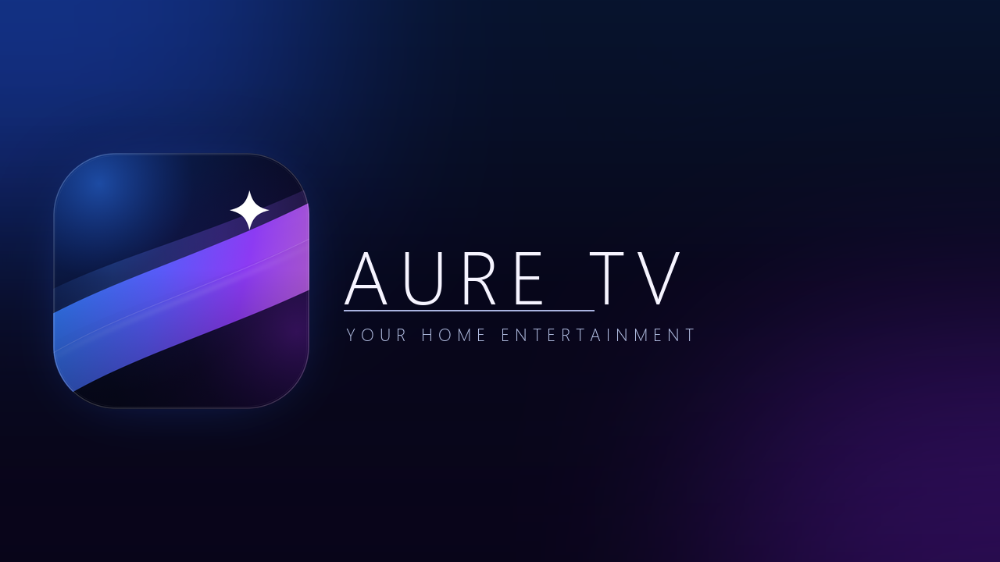

AURE TV — это Главная, а не ещё один каталог стриминга. Он собирает уже
установленные приложения в спокойный интерфейс: сетка приложений с фокусом,
папки, профили, системная полка Watch Next, погода, Control Center и настраиваемая
заставка. Рекомендации публикуют сами приложения; AURE TV не выдумывает тайтлы и
не подменяет пустую полку декоративными карточками.

## Попробовать в браузере

[Откройте интерактивное превью](https://whatuneeed.github.io/AureTV/), чтобы
пройтись по полке, поиску, Control Center, погоде, настройкам и Aerial-заставке.
Работают клавиатура, D-pad и мышь, переключение русского и английского языков;
всё остаётся локально в странице. В превью используются вымышленные демо-тайтлы,
это не установочный APK.

## Скриншоты

| Реальные рекомендации из установленных приложений | Приложения и док |
| --- | --- |
| 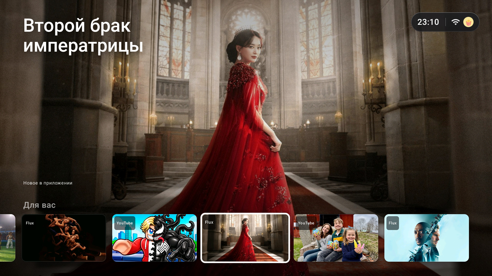 | 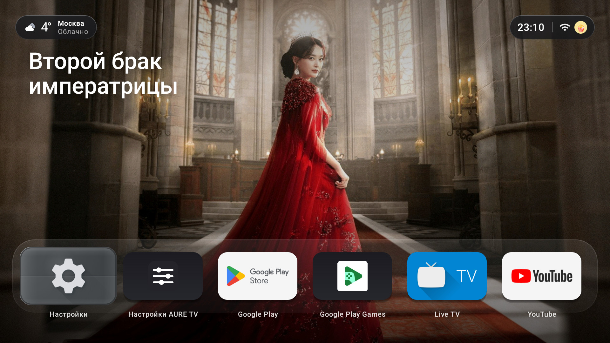 |

| Control Center | Погода |
| --- | --- |
| 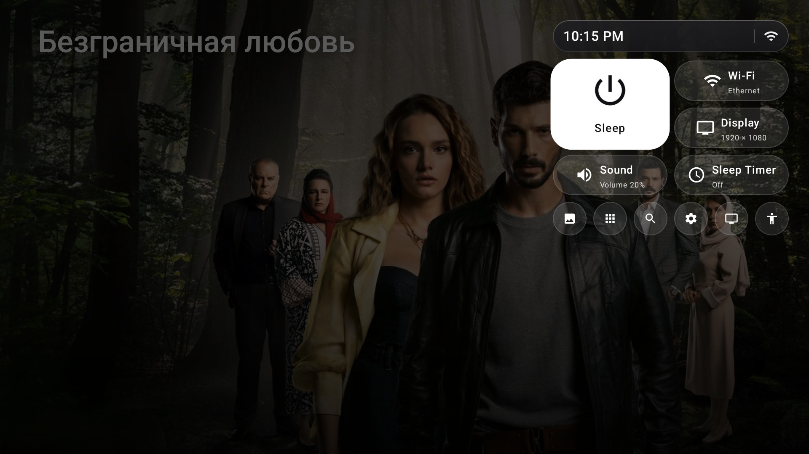 | 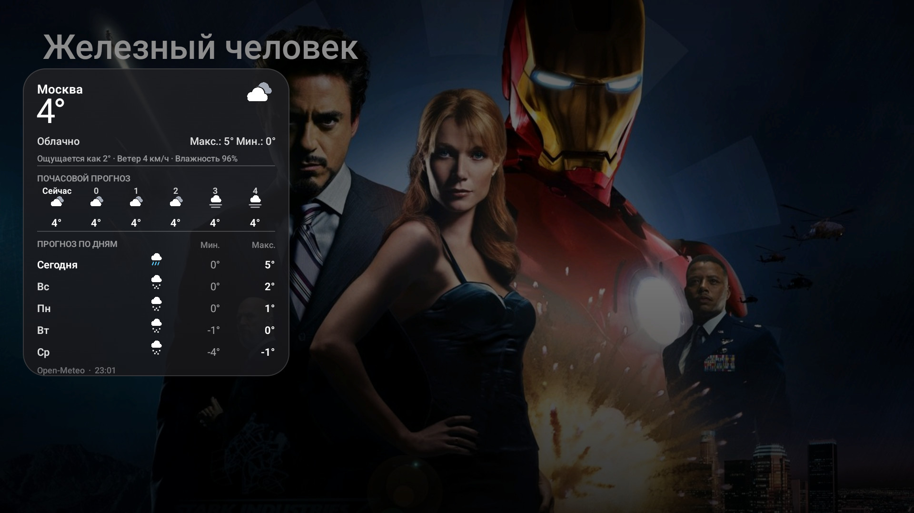 |

| Поиск с пульта | Aerial-заставка |
| --- | --- |
| 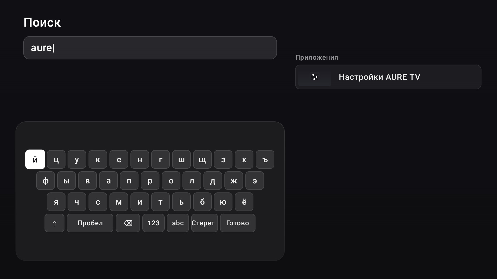 | 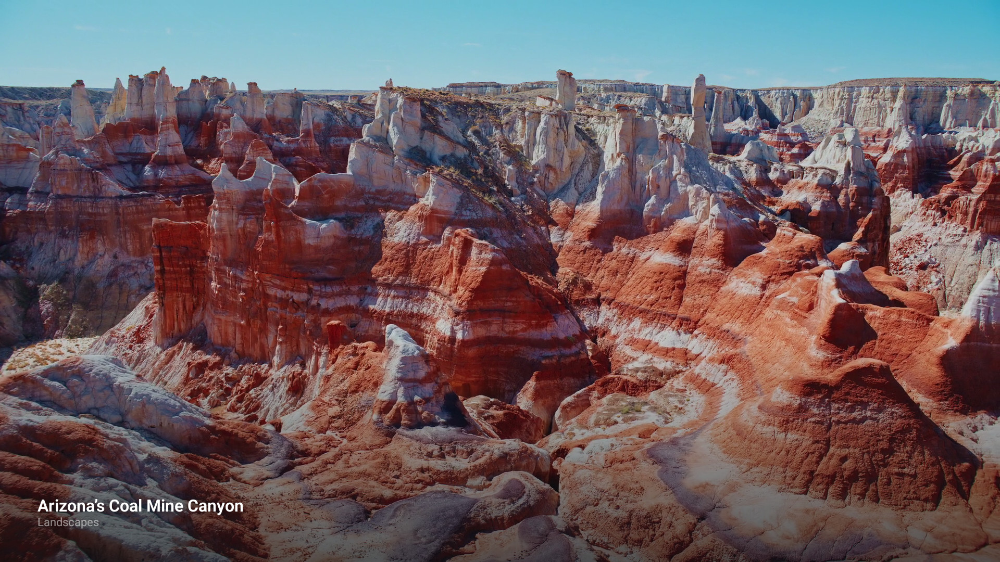 |

| Резервные копии | Настройки |
| --- | --- |
| 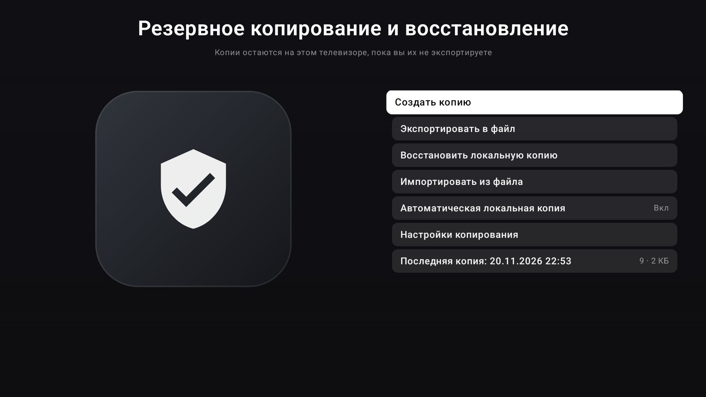 | 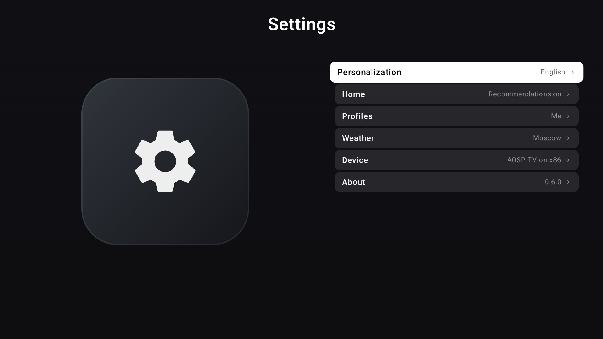 |

<details>
<summary>Ещё экраны: настройки заставки и первичная настройка</summary>

| Ambient Experience | Первичная настройка |
| --- | --- |
| 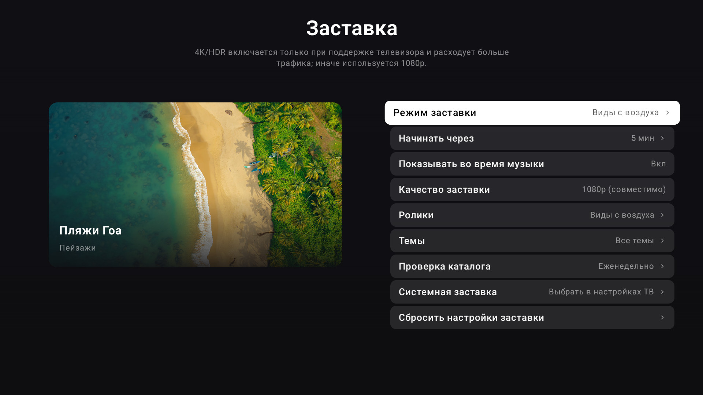 | 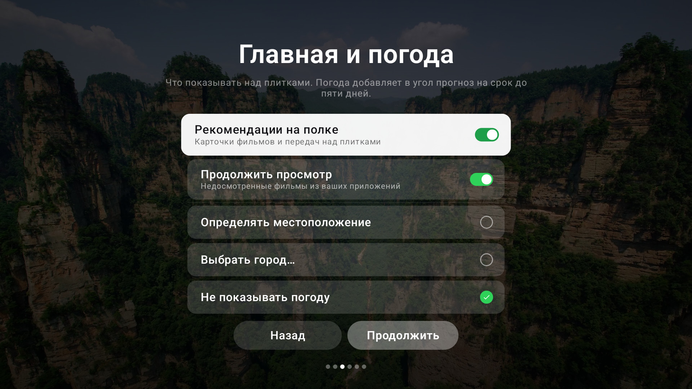 |

</details>

На первом скриншоте полка показывает реальные строки Watch Next, которые
опубликовали установленные приложения на тестовом устройстве. Приложения-
источники не входят в APK: лаунчер читает строки TV-провайдера, которые они
публикуют. Если ни одно приложение ничего не публикует, полка остаётся пустой.

## Чем отличается

- **Сделано для пульта, а не мыши.** Курсор D-pad — источник истины; у фокуса,
  Back, OK и Menu есть явные точки входа и возврата на каждом экране.
- **Только реальный контент.** Полка использует системный Android TV Watch Next.
  Постеры, названия и метки приложений приходят от установленных
  приложений-источников. Никакого выдуманного каталога и фальшивого
  «продолжить просмотр».
- **Спокойная Главная.** Никаких лент, борющихся за внимание, рекламы и
  аккаунта. Приложения можно скрывать, переименовывать и собирать в папки.
- **Локальность по умолчанию.** Резервные копии — локальные файлы, при желании
  защищённые паролем. В приложении нет аналитики и рекламных SDK.
- **Полноценная TV-поверхность.** Погода, поиск, профили и детский режим,
  Control Center, заставки Aerial/Clock/Photos/Reddit и настройка из шести
  экранов.
- **Два языка.** Английский и русский, с одинаковым набором возможностей.

## Возможности

### Главная и навигация

- Сетка приложений с фокусом, док, папки, перестановка, скрытие и
  переименование, отдельное меню приложения.
- Поиск по кнопке Search/Assist на пульте и экранная клавиатура для D-pad.
- Профили с именем, эмодзи и цветом; отдельный детский режим с PIN на выход и
  списком разрешённых приложений.
- Погода: текущие условия, почасовые детали и прогноз на пять дней. Источник —
  Open-Meteo с резервными провайдерами.
- Полка Watch Next из системного TV-провайдера. Карточка открывает приложение,
  показывает необязательные онлайн-детали/трейлер или возвращается в
  приложение-источник, когда доступен его deep link.
- Control Center: сеть, дисплей, звук, таймер сна, поиск, Настройки, заставка и
  системная TV-поверхность.
- AURE TV можно выбрать домашним приложением. Необязательная
  Accessibility-служба помогает на устройствах, которые возвращают стоковый
  лаунчер; для обычной работы она не требуется.

### Ambient Experience

- **Aerials** — реальные клипы из публичного каталога Apple с темами. Базовый
  совместимый вариант — 1080p H.264; более высокие рендишены выбираются только
  при поддержке дисплея и декодера, с конечным откатом на 1080p.
- Режимы **Clock**, **Minimal**, **Photos** и **Reddit**. Фото остаются на
  телевизоре; Reddit — сторонний немодерируемый источник, в детском режиме он
  отключён.
- Фильтры Aerial, задержка запуска, сдвиг пикселей, затемнение, максимальная
  сессия, погода и поведение при музыке.
- Офлайн-устойчивость: если клип или сеть недоступны, заставка оставляет
  локальный кадр или часы, а не чёрный экран.

### Резервные копии и восстановление

- Локальные снимки и экспорт/импорт через системный файловый пикер.
- Выбор данных для восстановления: профили, раскладка Главной,
  избранное/рекомендации, детский список, погода, заставка, язык/контент и
  поведение при старте.
- Необязательная защита паролем: AES-256-GCM и PBKDF2-HMAC-SHA256.
- Проверка архива, журнал восстановления и копия для отката перед заменой
  выбранных настроек. Автоматические локальные копии можно включить.
- Разрешения и роль Home намеренно не восстанавливаются: на новом устройстве
  их выдаёт пользователь.

### Приватность и сеть

- Нет аккаунта, аналитики, рекламных SDK и телеметрии.
- Онлайн-метаданные и трейлеры необязательны и никогда не используются в
  детском режиме.
- Клиенты работают по HTTPS с явной проверкой редиректов. Единственное
  исключение cleartext — документированный хост Apple Aerial CDN; внешние
  редиректы вслепую не выполняются.
- Резервные копии остаются на телевизоре, пока пользователь сам их не
  экспортирует. Фото и ленты Reddit в копии не попадают.
- Лаунчер запрашивает только нужные поверхности launcher/Home/TV provider и не
  использует `QUERY_ALL_PACKAGES`.

### Обновления

Сборки начиная с 0.6.1 проверяют HTTPS-метаданные релиза по адресу
`https://whatuneeed.github.io/AureTV/update.json`. Сам JSON криптографически не
подписан: доверие дают HTTPS, строгий allowlist хостов, заявленные размер и
SHA-256, а также сверка подписи APK с установленным приложением. Workflow
`.github/workflows/publish-update.yml` пересоздаёт этот файл из APK,
прикреплённого к опубликованному GitHub-релизу, а GitHub Pages его отдаёт.
Лаунчер скачивает только по HTTPS с разрешённых хостов GitHub, проверяет
SHA-256 и подпись APK, затем передаёт финальную установку системному
PackageInstaller — тихих обновлений нет.

Канал появился в 0.6.1. Если у вас 0.6.0, один раз установите 0.6.1 или
новее вручную; после этого новые версии ставятся из
**«Настройки → Устройство → Обновление ПО»** не выходя из лаунчера.

## Установка

**Требования:** Android TV 9 или новее (API 28+). Для самого лаунчера аккаунт
Google не нужен.

1. Скачайте `AURE-TV-0.6.2.apk` из GitHub Release.
2. Установите через ADB:

   ```bash
   adb install AURE-TV-0.6.2.apk
   ```

   Либо откройте APK файловым менеджером на телевизоре и подтвердите установку
   в системном окне.
3. Откройте **AURE TV** и пройдите настройку из шести экранов.
4. Чтобы лаунчер стал Главной, выберите **AURE TV** в системной настройке
   Home/лаунчера. Точный путь зависит от прошивки.
5. Для рекомендаций разрешите **Recommendations Access** в мастере настройки
   или позже в AURE TV → Настройки → Главная. Это разрешение
   `READ_TV_LISTINGS`; без него полка не сможет прочитать Watch Next.
6. Приложение-источник должно быть установлено и публиковать строки Watch
   Next, иначе его карточек не будет.

## Проверка

Релиз 0.6.2 проверен на эмуляторе Android TV `hume-tv` (API 34, x86,
1920×1080):

| Проверка | Результат |
| --- | --- |
| JVM unit-тесты | 588 / 588 |
| Connected instrumentation | 305 / 305 на 0.6.2 |
| Android lint | 0 ошибок, 17 предупреждений на 0.6.2 |
| Release APK | подписан, APK Signature Scheme v2 |
| Пакет / версия | `app.aure.tv`, 0.6.2 (versionCode 156) |

**Не проверено на физическом железе:** реальные ИК/BT-пульты, HDMI-CEC,
декодирование 4K/HDR на реальной панели, голос TalkBack, файловые пикеры
разных OEM и весь диапазон API 28–35. Результат эмулятора не заменяет проверку
в гостиной.

## Сборка

Проект использует Gradle wrapper и JDK 17.

```bash
./gradlew :app:assembleDebug
```

На рабочей машине кэш Gradle лежит в `C:/gradle-home`:

```bash
GRADLE_USER_HOME=C:/gradle-home ./gradlew :app:assembleDebug
```

Ключ подписи релиза намеренно не хранится в репозитории. Настройте
`OVISIONTV_SIGNING_PROPERTIES` (или `~/.ovisiontv/keystore.properties`) перед
сборкой распространяемого APK. Без этого release-сборка будет неподписанной.

### Тесты

```bash
./gradlew :app:lintDebug :app:testDebugUnitTest
./gradlew :app:connectedDebugAndroidTest
```

Точечный instrumentation-прогон:

```bash
./gradlew :app:connectedDebugAndroidTest \
  -Pandroid.testInstrumentationRunnerArguments.class=app.aure.tv.ui.HomeScreenTest
```

### Release gate

```bash
python tools/release_check.py \
  --apksigner 'C:/Users/5518~1/AppData/Local/Android/Sdk/build-tools/36.0.0/apksigner.bat'
```

Скрипт проверяет `versionCode`, `versionName`, `applicationId`, уровни SDK,
подпись v2, сертификат и паритет имён ресурсов RU/EN. История исправлений и материалы текущего релиза — в [`GITHUB_RELEASE/`](GITHUB_RELEASE/).

## Структура проекта

- `data/` — настройки, профили, репозиторий приложений, погода, Watch Next,
  каталог Aerial и политика возможностей устройства.
- `discovery/` — детерминированный и тестируемый построитель рекомендаций.
- `online/` — необязательные HTTPS-клиенты метаданных/превью; по умолчанию
  выключены.
- `backup/` — архив, шифрование AES-256-GCM, проверка, восстановление, журнал и
  откат, планировщик и storage gate.
- `update/` — необязательные метаданные/загрузчик/установщик; отключены, если
  URL при сборке пуст.
- `ui/` — Compose-экраны и TV-поверхности фокуса. Целочисленные индексы курсора
  — источник истины; пульт и TalkBack используют одни и те же действия.

## Благодарности и лицензия

AURE TV распространяется по **Apache License 2.0**. Уведомления третьих сторон —
в [`NOTICE`](NOTICE). Клипы Aerial транслируются с публичного CDN Apple; AURE TV
не связан с Apple. Названия сторонних продуктов принадлежат их владельцам. DRM и сторонний контент в APK не входят.
